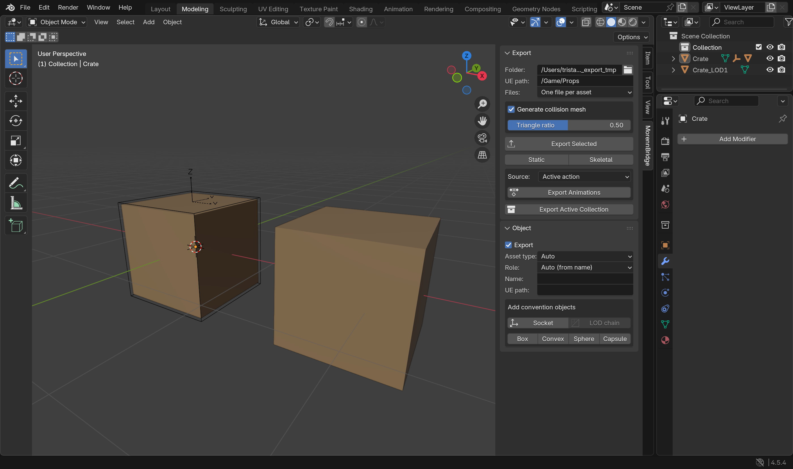
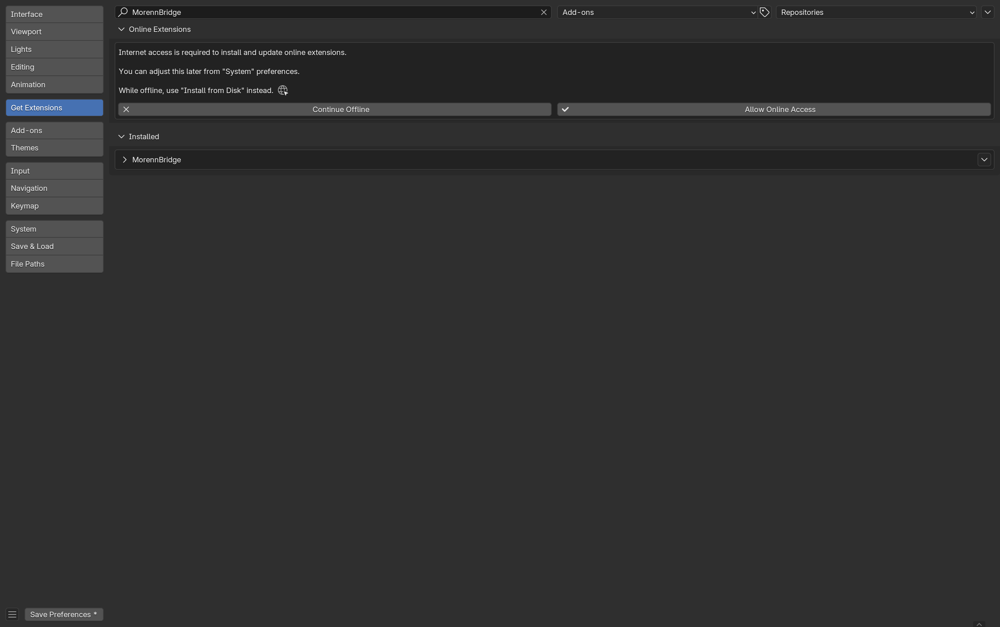

# MorennBridge

### A Blender ⇄ Unreal Engine 5 bridge that simplifies the workflow

[](https://github.com/ManerMorenn/MorennBridge/actions/workflows/ci.yml)
[](https://github.com/ManerMorenn/MorennBridge/releases)
[](https://www.blender.org/download/)
[](https://www.unrealengine.com/)
[](LICENSE)
[](https://morennbridge.manermorenn.com)

FBX interchange between Blender (4.5 and newer) and Unreal Engine 5, done the way Unreal expects.

Blender and Unreal disagree on units, axes, bone orientation and a dozen exporter checkboxes. MorennBridge encodes
the correct conventions once and turns them into buttons: set the scene up for Unreal, export static meshes,
skeletal meshes and animations that import cleanly, import Unreal exports with proper bones, validate before you
write anything, and (optionally) push assets straight into a running editor.



## Features

- **Scene setup**: centimetre units (1 unit = 1 cm), 30 fps, viewport clip range and grid that work at
  Unreal scale, camera clip ranges. A converter rescales existing metre scenes without changing physical sizes.
- **Export**: static meshes (`SM_`), skeletal meshes (`SKM_`) and animations (`A_`), auto-named and
  auto-classified. Curves, text, metaballs, Geometry Nodes instances and collection instances export as meshes.
  Files are written in Unreal's own axis convention and in centimetres, with smoothing groups,
  tangents, triangulation, no leaf bones, a single root bone, baked animation on every frame and no scaled armature.
  Several meshes can share one file and still become separately named Unreal assets.
- **Unreal conventions**: `UCX_/UBX_/USP_/UCP_` collision, `SOCKET_` empties, LOD chains, an
  optional generated collision mesh (`SM_Name_COLL`, for Unreal's *Complex Collision Mesh* slot), shape keys kept
  through modifiers, bone-influence limiting, UE-safe names.
- **Import from Unreal**: the `root` bone is restored (Blender's importer otherwise swallows it), every bone is
  re-oriented to Blender's convention *per bone* (UE4/ALS mannequins mirror whole limbs), bones get sensible lengths
  and collections, LOD groups and collision meshes are recognised, actions are renamed after the file. Exact: a
  re-export reproduces the original Unreal bone transforms.
- **Pre-flight validation**: errors and warnings with one-click fixes (apply mirrored scale, add a root bone, rename
  bones the way Unreal would, bind bone-parented props, assign a default material, …).
- **Unreal Link**: discover a running Unreal Editor, push the last export (an Interchange or legacy import driven by
  a manifest), pull selected assets back. Needs the Python remote execution setting in your project; see
  [Unreal setup](docs/UE_SETUP.md). Verified with Unreal Engine 5.8.4.

## Install

1. Download `morennbridge-<version>.zip` from the releases page, or build it from a checkout with
   `blender --command extension build --source-dir . --output-dir dist`.
2. Blender → *Edit → Preferences → Get Extensions → ⌄ (top right) → Install from Disk…* → pick the zip. It works
   offline; the extension is enabled immediately and listed under *Installed*.
3. The add-on appears as the **MorennBridge** tab in the 3D Viewport sidebar (`N`). Its settings are under
   *Preferences → Add-ons → MorennBridge*.



Developers can symlink the `morennbridge` folder into `<Blender config>/extensions/user_default/` instead.

## Quick start

1. **Scene → Set Up Scene for Unreal** (or *Convert Scene to Unreal Units* for an existing metre scene).
2. Model as usual: 1 unit = 1 cm, faces visible in Blender's *Front* view face +Y in Unreal, like Epic's mannequins.
3. Select your objects, set the export folder and UE path in the **Export** panel, press **Export Selected**.
   Rigged meshes and armatures become skeletal meshes, everything else static meshes; the **Export Animations**
   button writes one FBX per action, NLA strip or scene range.
4. Fix anything the **Pre-flight** panel reports (it runs automatically before every export).
5. In Unreal, drop the files in the Content Browser (settings in `docs/CONVENTIONS.md`) or use **Unreal Link**.

The full walkthrough with screenshots is in [`docs/USER_GUIDE.md`](docs/USER_GUIDE.md).

## Documentation

The documentation is also published at <https://morennbridge.manermorenn.com>.

| Document | Content |
|---|---|
| [`docs/USER_GUIDE.md`](docs/USER_GUIDE.md) | Installation, every panel step by step, preferences, with screenshots |
| [`docs/TUTORIALS.md`](docs/TUTORIALS.md) | A static prop, a character and an animation from start to finish |
| [`docs/CONVENTIONS.md`](docs/CONVENTIONS.md) | Naming rules, axes/units, manifest format, manual Unreal import settings |
| [`docs/ISSUES.md`](docs/ISSUES.md) | Every pre-flight issue code and what to do about it |
| [`docs/UE_SETUP.md`](docs/UE_SETUP.md) | Unreal project setup for remote execution, legacy importer switch, troubleshooting |
| [`docs/SUPPORT.md`](docs/SUPPORT.md) | Supported versions, known limitations, FAQ, privacy |

## Requirements and status

- Blender 4.5 or newer, tested on 4.5 LTS, 5.0, 5.1 and 5.2 LTS. Uses Blender's FBX exporter and importer plus a
  binary post-pass.
- Unreal Engine 5.8, verified with 5.8.4 (Interchange import by default, legacy importer supported).
- The Blender side is covered by the test suite, the Unreal side by a smoke test in the editor; see the
  [support page](docs/SUPPORT.md).

## Development

```
# tests: Blender runs them headless (the runner links the checkout into the user extensions repository)
blender -b --factory-startup --python tests/run_tests.py -- [-k pattern] [-v]
# panels and undo, in a real window that closes by itself
blender --factory-startup --python tests/gui_session.py
# lint and formatting (same commands as CI)
ruff check . && ruff format --check .
# package
blender --command extension validate . && blender --command extension build --source-dir . --output-dir dist
# documentation screenshots (opens a Blender window for about a minute, then a background crop pass)
blender --factory-startup --window-geometry 0 0 1400 850 blank.blend \
    --python dev/make_screenshots.py -- docs/images [UnrealExport.fbx]
blender -b --python dev/make_screenshots.py -- --crop docs/images
# documentation site (what GitHub Pages serves; needs `pip install markdown pymdown-extensions pygments`)
python dev/build_site.py --out site
```

CI (GitHub Actions) lints, runs the suite on every supported Blender version on Linux and on the LTS releases on
Windows and macOS, measures coverage, and installs the built zip into a clean profile. Tags `v*` publish the zip on
the release page; pushes to `main` redeploy the documentation site. See [CONTRIBUTING.md](CONTRIBUTING.md) and
[CHANGELOG.md](CHANGELOG.md).

License: GPL-3.0-or-later (the add-on bundles Blender's GPL FBX reader and writer). The scripts that run inside the
Unreal Editor (`ue/scripts`) are under the MIT License. See [NOTICE.md](NOTICE.md) for what the license does not cover.
