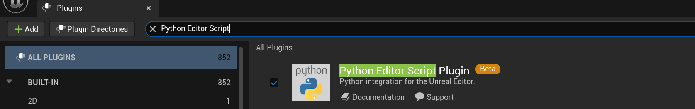
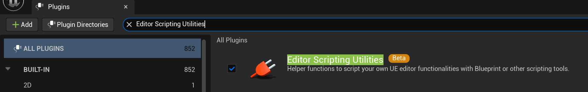
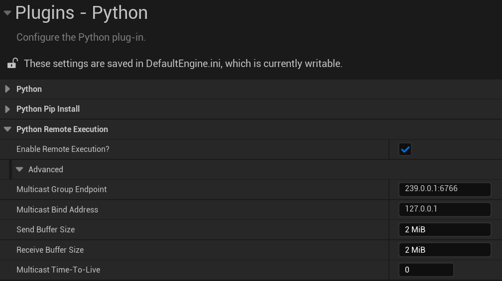
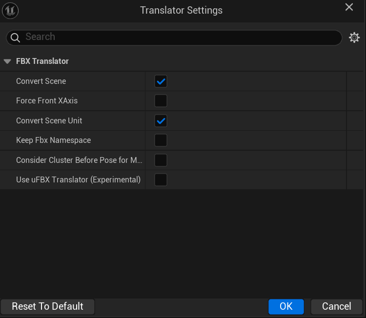
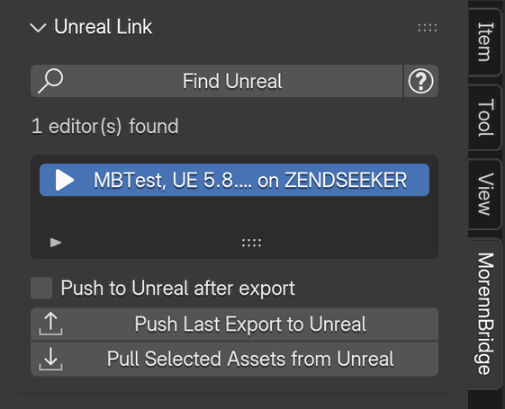

# Unreal Engine setup for MorennBridge

For Unreal Engine 5.8, verified with UE 5.8.4 on Windows. See [Support](SUPPORT.md).

## 1. Importing the files
Drop the exported `.fbx` files into the Content Browser. The files are already in Unreal's axis system and in
centimetres, so the defaults mostly work. The settings that matter are listed in
[Conventions](CONVENTIONS.md#manual-unreal-import-settings).

Recommended folder layout: `/Game/<Project>/Props/SM_*`, `/Game/<Project>/Characters/<Name>/SKM_* | SKEL_* | PHYS_*`,
`/Game/<Project>/Characters/<Name>/Animations/A_*`. The `destination_path` of each item in the `.morenn.json`
manifest records where MorennBridge expects the asset.

## 2. Push to Unreal: UE 5.8 project settings for remote execution
1. **Edit → Plugins**: enable *Python Editor Script Plugin* and *Editor Scripting Utilities*, then restart the
   editor. Both are off by default in UE 5.8. Plugins that are on by default load them as dependencies (Niagara and
   RigVM need Python; Bridge, Fab and PCG need Editor Scripting Utilities), so most projects have them already;
   enabling them yourself keeps the bridge working in a project that turns those plugins off.

    

    

2. **Edit → Project Settings → Plugins → Python**, section *Python Remote Execution*: *Enable Remote Execution?*
   **on**. It is a project setting, not one of the Editor Preferences where Python's *Developer Mode* is. The
   advanced settings of the section keep their defaults, which match the add-on:
    - *Multicast Group Endpoint*: `239.0.0.1:6766`
    - *Multicast Bind Address*: `127.0.0.1`. On macOS/Linux this address sometimes does not receive multicast: set
      `0.0.0.0` when *Find Unreal* finds nothing
    - *Multicast Time-To-Live*: `0` (same machine only)

    

    The editor writes the setting to `Config/DefaultEngine.ini`:

    ```ini
    [/Script/PythonScriptPlugin.PythonScriptPluginSettings]
    bRemoteExecution=True
    ```

3. **Firewall**: allow the editor to accept local connections (the bridge only uses loopback traffic).
4. **Interchange FBX translator**: these settings belong to each user and are not in Project Settings. In the
   Interchange import dialog, the three-dot button at the end of the *Import Source* line opens
   *Translator Settings*; keep *Force Front XAxis* off for manual imports. A push imports with *Force Front XAxis* and
   the experimental uFBX translator off, then puts your settings back, and the Log says so.

    

5. **Blender**: Preferences → System → *Allow Online Access* must be enabled, otherwise the add-on refuses to open sockets.
6. In Blender's *Unreal Link* panel click *Find Unreal*; the project name appears in the list. Export with
   *Push to Unreal after export* enabled, or push the last export manually.

    

While remote execution is on, any program on this machine can run Python in the editor. Keep the TTL at `0`, and
turn the setting off on shared machines.

## 3. Legacy FBX importer (optional)
UE 5.8 imports FBX through Interchange. To target the legacy importer, set *UE importer = Legacy* in the
MorennBridge preferences (LOD groups are then written as real FBX LodGroup nodes, several meshes per file are not
supported, generated collision meshes go to separate files). A push then uses the legacy importer by itself. For
files you drag into the Content Browser, also add to `DefaultEngine.ini`:
```ini
[ConsoleVariables]
Interchange.FeatureFlags.Import.FBX=0
```

## 4. Troubleshooting
- **Extra `Armature` root bone**: the file was exported without the post-pass (or with *Strip armature null node*
  off) from a Blender armature not named `Armature`. Re-export with the option on.
- **Bones scaled ×100 / tiny character**: the scene was not in centimetres and the file was exported with another
  tool. MorennBridge always writes centimetres; run *Set Up Scene for Unreal*.
- **"No smoothing group information"**: exported with smoothing = *Normals only*; use *Smoothing groups*.
- **Animation not found / skeleton incompatible**: pick the Skeleton of the matching SKM_ asset; bone names must be
  identical (run *Validate* and fix `E010` on the Blender side).

### Unreal Link
- **Find Unreal: "No Unreal Editor found (see Setup help)"**: start the editor with the project open, then check
  steps 1 and 2: both plugins enabled, *Enable Remote Execution?* on, and the editor restarted after enabling the
  plugins. Blender's *Allow Online Access* must be on; the panel says so when it is off. On macOS and Linux, set the
  *Multicast Bind Address* to `0.0.0.0` (step 2).
- **"Unreal (…) did not connect back within 5s; check 'Enable Remote Execution' and the bind address"**: the editor
  answered *Find Unreal* but could not connect back to Blender. A firewall or security tool blocks the connection
  (allow the editor and Blender on this machine), or *Command IP* in the add-on preferences is an address the editor
  cannot reach: keep `127.0.0.1` when both run on the same machine.
- **"Not pushed to Unreal: no editor found yet, use Find Unreal in the Unreal Link panel"**: *Push to Unreal after
  export* needs an editor in the list. Click *Find Unreal* once in each Blender session.
- **"Not pushed to Unreal: the previous push is still running"**: wait until the panel shows *Done* or *Failed*, then
  click *Push Last Export to Unreal*.
- **"Unreal reported a Python error while importing (see the UE Output Log)"**: open *Window → Output Log* in the
  editor; the Python error is there. Blender's Log lists the editor's errors and warnings with a `UE:` prefix.
- **"No answer from Unreal within 600s"**: the import took longer than *Command timeout* in the add-on preferences,
  or the editor is waiting on a dialog. Look at the editor; raise the timeout for very large files.
