# MorennBridge user guide

## 0. Installation

MorennBridge is a Blender *extension* (Blender 4.2 or newer).

1. Get `morennbridge-<version>.zip` from the releases page, or build it yourself from a checkout with
   `blender --command extension build --source-dir . --output-dir dist`.
2. Open *Edit → Preferences → Get Extensions*. Click the **⌄** button at the top right of the page and choose
   **Install from Disk…**, then pick the zip. No internet access is needed for this; if Blender asks about online
   access you can choose *Continue Offline*.
3. The extension is enabled right away and listed under *Installed*. It stays enabled across sessions once you save
   the preferences (Blender does this automatically unless auto-save is off).

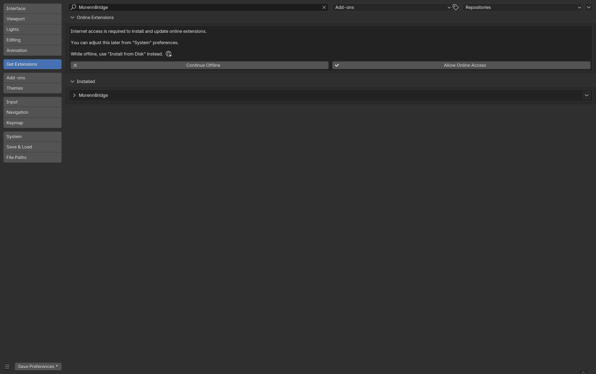

Developers can skip the zip and symlink the `morennbridge` folder into
`<Blender config>/extensions/user_default/morennbridge` instead (the test runner does exactly that).

To uninstall, open the same page, expand *MorennBridge* under *Installed* and use *Uninstall*.

## The sidebar tab

Everything lives in the **MorennBridge** tab of the 3D Viewport sidebar (press `N`). Panels, top to bottom:
Scene, Export, Import, Object, Armature, Pre-flight, Unreal Link, Log.

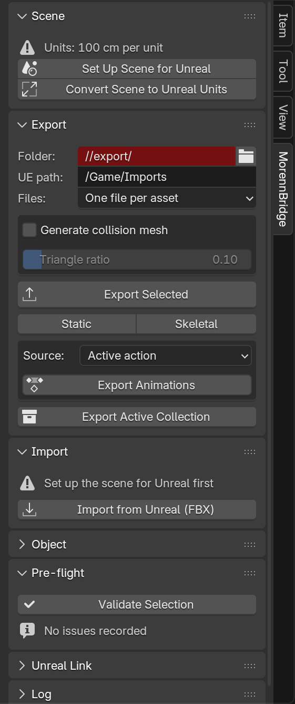

## 1. Set the scene up for Unreal

Unreal works in centimetres. Blender's default scene uses metres, which is what makes imported characters tiny,
armatures scaled by 100 and viewport clipping odd. The **Scene** panel shows the current state and offers two buttons.

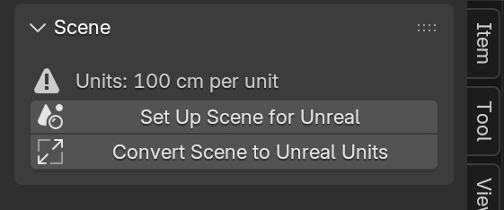

- **Set Up Scene for Unreal** sets metric units with 1 unit = 1 cm, 30 fps, a frame range starting at 0, and a clip
  range / grid scale suited to centimetres on every 3D viewport and camera. It changes settings only, never your
  geometry.
- **Convert Scene to Unreal Units** is for a scene that was built in metres: every length is multiplied by 100
  (meshes, curves, armatures, locations, location keyframes, common modifier settings, cameras, lights) and then the
  units are switched, so everything keeps its physical size. Linked data cannot be converted and is reported.

Both report what they did in the **Log** panel.

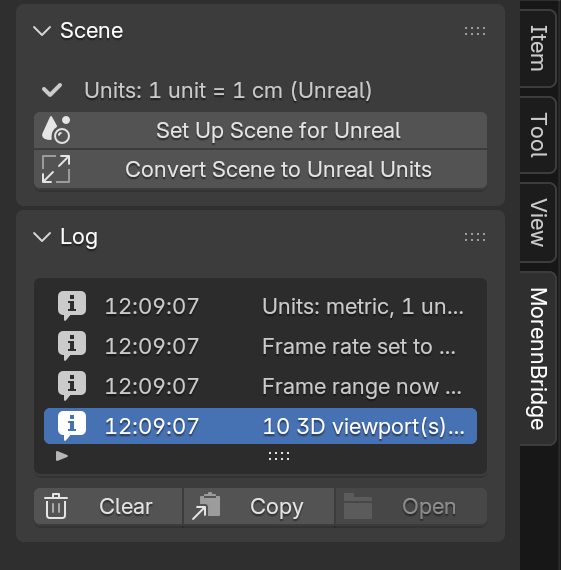

All values (clip range, fps, grid) are preferences: *Edit → Preferences → Add-ons → MorennBridge*.

## 2. Export static meshes

Select the objects and press **Export Selected** (or **Static** to force the type). Each selected mesh becomes one
`SM_<Name>.fbx` in the export folder, with its satellites:

| You create | MorennBridge exports |
|---|---|
| child mesh named `UCX_<Name>` / `UBX_` / `USP_` / `UCP_` (or role *Collision*) | `UCX_SM_<Name>_01` … simple collision |
| child empty named `SOCKET_<name>` (or role *Socket*) | `SOCKET_<name>`, an Unreal socket |
| meshes `<Name>_LOD1`, `<Name>_LOD2` … (or role *LOD* with an index) | LOD chain (`LOD1_SM_<Name>` …) |
| **Generate collision mesh** checked | `SM_<Name>_COLL`, a decimated copy for Unreal's *Complex Collision Mesh* slot |

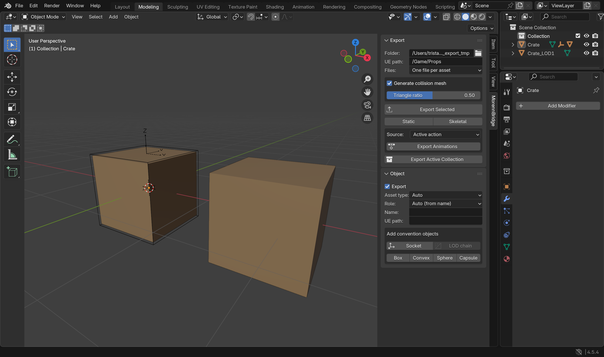

Settings in the panel: the export **folder**, the Unreal content **path** written into the manifest, **Files**
(one FBX per asset, or one combined file whose nodes become separately named assets), and the **triangle ratio** of
the generated collision mesh (0.1 keeps 10 % of the triangles; tiny meshes fall back to an undecimated copy).

What happens on export, so you do not have to think about it:

- names are normalised (`Crate.001` → `SM_Crate`, an existing `SM_` prefix is not doubled; set *Name* in the
  Object panel to override), characters Unreal would rewrite are replaced;
- the mesh is evaluated with its modifiers, triangulated, written at the origin with rotation and scale applied,
  with smoothing groups, custom normals, tangents, UVs and vertex colours;
- the file is in Unreal's axis system and in centimetres, so Unreal rotates and scales nothing; a Blender object
  facing −Y (visible in *Front* view) faces +Y in Unreal, the same orientation as Epic's mannequins;
- a `<batch>.morenn.json` manifest next to the files records what was written and how Unreal should import it.

The **Log** panel lists each file (double-click opens the folder); the **Object** panel holds per-object overrides:
export name, Unreal destination path, role, LOD index and parent, collision type, and buttons that create
convention objects (socket, box/convex/sphere/capsule collision, LOD chain) for the active mesh.

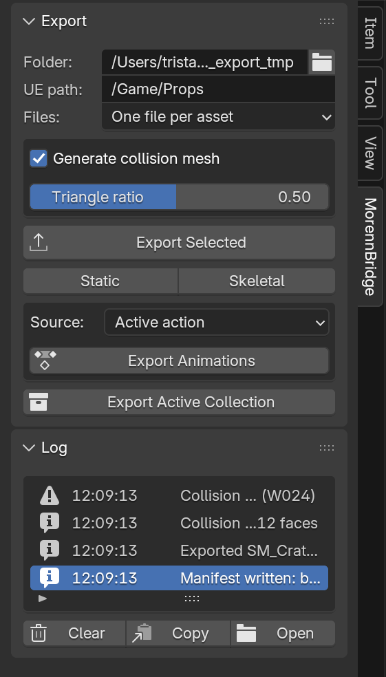

## 3. Export skeletal meshes and animations

Select the armature (or any mesh skinned to it) and press **Export Selected** or **Skeletal**. The armature and all
meshes skinned to it become one `SKM_<Name>.fbx`. Rules that make Unreal happy are enforced for you:

- a single root bone (the pre-flight check offers to add one); the armature *object* must not be animated: root
  motion belongs on the root bone;
- exported bones are the deform bones, bones tagged *Always export* (Armature panel), `ik_*` and `SOCKET_*` bones,
  and their ancestors; weights on other bones are merged into the nearest exported ancestor; at most eight
  influences per vertex (preference);
- shape keys survive modifiers, morph targets are exported;
- bones are written with the X axis along the bone (Unreal/Maya convention) for Blender-made rigs; rigs imported
  from Unreal keep their original convention bone by bone, so re-exports match the Unreal skeleton exactly;
- the temporary `Armature` node Blender normally adds above the root bone is removed from the file, so the root
  bone is the real root in Unreal and no extra bone appears.

**Export Animations** writes one FBX per animation, named `A_<Rig>_<Action>`. The **Source** dropdown chooses the
active action, every action of the rig, each NLA strip, or the scene frame range. The pose is baked visually, so
constraints, drivers and NLA blending are included, every frame gets a key, and the file carries only the skeleton
(the mesh is optional, preference *Include mesh in animation files*). In Unreal, import these onto the Skeleton
created by the matching `SKM_` import.

## 4. Pre-flight validation

**Validate Selection** (also run automatically by every export) lists problems with a code, a severity and, when
possible, a one-click fix. Errors block the export; warnings do not.

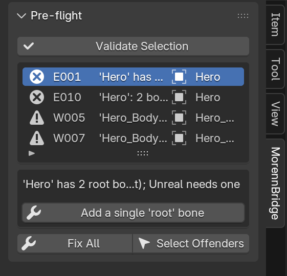

Typical items: `E001` several root bones (fix: add `root`), `E003` mirrored scale (fix: apply), `E010` bone names
Unreal would rewrite such as `spine.001` (fix: rename them the way Unreal would, so names match on both sides),
`E004` prop parented to a bone without skinning (fix: rigid bind), `W005` missing UV map, `W007` empty material slot
(fix: assign `M_Default`), `W016` scene not in centimetres (fix: set up scene), `I009` too many bone influences.
*Fix All* applies every available fix; *Select Offenders* selects the objects involved.

## 5. Import from Unreal

**Import → Import from Unreal (FBX)** accepts one or several files exported by Unreal (static meshes, skeletal
meshes, animations). Compared with Blender's stock importer:

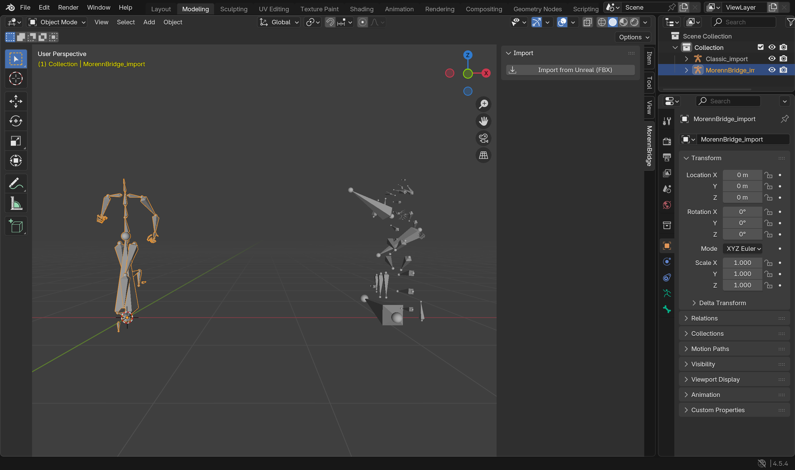

- the `root` bone is a real bone again (the stock importer turns Unreal's root node into the armature object);
- every bone is re-oriented so that it points to its child, bone by bone: Unreal skeletons are not uniform (UE4 and
  ALS mannequins use the opposite axis on the right arm and the left leg, the root points up, feet point forward);
  the change is exact, so animations and re-exports stay correct;
- bones get sensible lengths (toward the farthest aligned child; twist and IK helpers short), collections
  *Deform / IK / Helpers*, and the per-bone axis is stored and shown in the Armature panel;
- the armature is named after the asset, meshes `<Asset>_Mesh`, `UCX_` meshes become wire collision objects
  parented to their mesh, Unreal LOD groups become LOD chains, the action is renamed after the file;
- data arrives in centimetres; a metre scene is rescaled automatically (the panel suggests running the scene setup
  first).

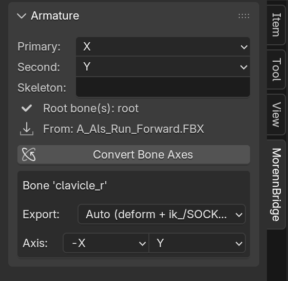

Options on the import dialog: *Convert bone axes*, *Tidy hierarchy*, *Reset pose*. The Armature panel lets you
flip the convention of a whole rig later (**Convert Bone Axes**) and override the axis of a single bone.

## 6. Unreal Link (push and pull)

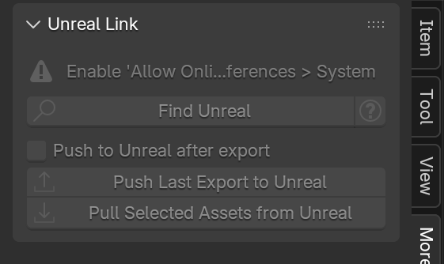

With Python remote execution enabled in the Unreal project (`UE_SETUP.md`, two settings), **Find Unreal** lists the
running editors. **Push Last Export to Unreal** imports the last manifest with the correct Interchange (or legacy)
settings, renames the skeleton and physics asset with your prefixes, links the generated collision mesh as Complex
Collision Mesh and saves. **Pull Selected Assets from Unreal** exports the assets selected in Unreal's Content
Browser and imports them here. Blender's *Allow Online Access* preference must be on.

This part has not been run against a live editor yet. Property names on the Unreal side that do not exist in a
given engine version are skipped and logged.

## 7. Preferences

*Edit → Preferences → Add-ons → MorennBridge* (expand the entry). Everything the buttons do is driven by these
settings; the defaults are what the rest of this guide describes.

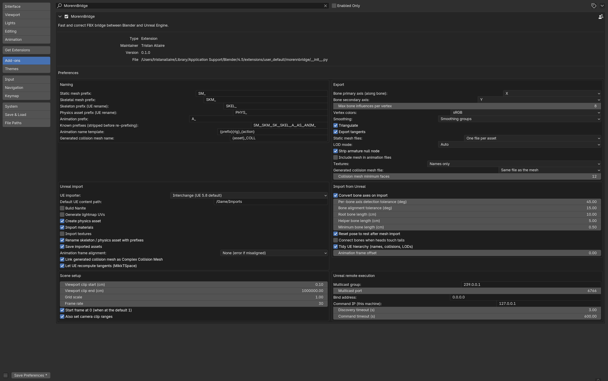

| Group | Settings |
|---|---|
| **Naming** | Prefixes for static meshes (`SM_`), skeletal meshes (`SKM_`), skeleton (`SKEL_`) and physics asset (`PHYS_`, both applied by the Unreal-side script), animations (`A_`); the list of known prefixes that are stripped before re-prefixing; the animation name template `{prefix}{rig}_{action}`; the generated collision mesh name `{asset}_COLL`. |
| **Export** | Bone axis convention for Blender-made rigs (primary = Unreal axis along the bone, default X; secondary default Y); max bone influences per vertex (8); vertex colour space (sRGB); smoothing (smoothing groups); triangulate; export tangents; static mesh files (one per asset or combined); LOD mode (Auto = `LOD<i>_Name` pattern for Interchange, FBX LOD group nodes for the legacy importer); strip the armature null node (keep on); include the mesh in animation files; textures (names only or copy next to the FBX); generated collision mesh file (same file or separate) and its minimum face count. |
| **Unreal import** | Which Unreal importer the files target (Interchange, the UE 5.8 default, or legacy); default UE content path; Nanite; lightmap UV generation; physics asset creation; materials and textures; renaming of skeleton/physics asset; saving; animation frame alignment; linking the generated collision mesh as Complex Collision Mesh; letting Unreal recompute tangents. These feed the manifest and the push script. |
| **Import from Unreal** | Convert bone axes; per-bone axis detection tolerance (45°); bone alignment tolerance for lengths (15°); root, helper and minimum bone lengths (cm); reset pose after mesh import; connect bones when heads touch tails; tidy the hierarchy; animation frame offset. |
| **Scene setup** | Viewport clip start/end (cm), grid scale, frame rate, start frame at 0, camera clip ranges. |
| **Unreal remote execution** | Multicast group and port (`239.0.0.1:6766`), bind address (`0.0.0.0` works on macOS), command IP (this machine, `127.0.0.1`), discovery and command timeouts. Must match the Unreal project's Python settings (`UE_SETUP.md`). |

Per-object and per-armature overrides live in the **Object** and **Armature** panels, not in the preferences.

## 8. Checking the result in Unreal

Until the push feature is confirmed, import manually with the settings listed in `CONVENTIONS.md`, then check:

1. a combined file gives one asset per node with the right names, `SM_x` and `SM_x_COLL` from one file;
2. LOD chains and collision pieces bind to the right mesh;
3. skeletal meshes have a single root bone, no `Armature` bone, bones at scale 1, the reference pose equal to the
   Blender rest pose; a re-exported Unreal character round-trips;
4. animations have the right length at 30 and 24 fps and play on the original Unreal skeleton;
5. morph targets, vertex colours (sRGB by default) and the complex collision mesh behave as expected.
